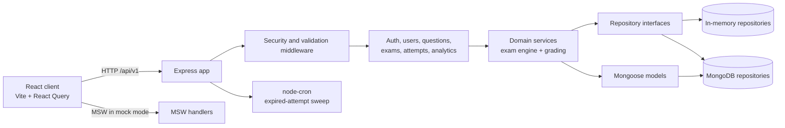

# ExamGuard

ExamGuard is a full-stack online examination platform for teachers, students, and administrators. It combines exam authoring, question-bank management, timed attempts, autosave, grading, analytics, and browser-based integrity signals behind a contract-first Express API and a responsive React client. The project is designed to demonstrate production-minded engineering decisions: the server remains authoritative for time and state, submissions are idempotent, published exams are immutable snapshots, and persistence is isolated behind repositories that can use either in-memory or MongoDB implementations.

## Demo

- **Local demo:** [http://localhost:5173](http://localhost:5173) after following the setup steps below.
- **Hosted demo:** No public deployment is configured in this repository yet. Replace this section with the deployment URL when one is available.
- **Demo credentials:** Permanent credentials are intentionally not committed. For an isolated local demo, enable fixture seeding with `SEED_ON_START=true`, or provision temporary accounts with `npm run create-admin --workspace server`. Never publish production administrator credentials.

## Features

- Role-based workflows for students, teachers, and administrators.
- Teacher question-bank CRUD, filtering, search, pagination, CSV/XLSX import, and soft deletion.
- Draft exam builder with question ordering, marks, timing, batches, join codes, and publish validation.
- Published-exam schedule editing and teacher-owned exam deletion.
- Student exam discovery, code joining, timed attempts, resume support, and result release controls.
- Server-side grading for single-choice, multi-choice, and numeric questions, including negative and partial marking.
- Autosaved answers with stale-update protection and a five-second in-flight grace window.
- Browser integrity signals such as tab changes, window blur, fullscreen exit, copy/paste, context-menu, and shortcut events.
- Teacher monitoring with violation counts and capped event history.
- Refresh-token rotation, token-version invalidation, bcrypt password hashing, rate limiting, Helmet, CORS allowlisting, and request validation.
- MongoDB persistence with repository contracts and an in-memory implementation for fast tests and development.

## Architecture



## Key engineering decisions

- **Server-authoritative time:** attempt start, expiry, exam phase, grace windows, and result availability are computed from server time rather than trusting browser clocks.
- **Idempotent submit:** `finalizeIfInProgress` performs a conditional state transition. Repeated submit requests return the already-finalized attempt instead of grading twice.
- **Published snapshotting:** publishing stores question text, options, correct answers, marks, and exam settings in the exam snapshot so later question-bank edits cannot change an active exam.
- **Autosave with ordering:** answers include a client sequence and update time; stale writes are ignored, and Mongo updates use conditional filters for atomicity.
- **Repository pattern:** services depend on domain-level repository interfaces rather than Mongoose. `REPOSITORY_DRIVER=memory` supports local development and tests; `REPOSITORY_DRIVER=mongo` provides persistent storage.
- **Contract-first boundaries:** request validation and response envelopes are shared against the frozen API contract, keeping the React client and server independently testable.
- **Defense in depth:** access tokens are short-lived, refresh tokens rotate and can be invalidated with `tokenVersion`, authentication is rate-limited, and production rejects development JWT secrets.

## Tech stack

**Client:** React 18, React Router, React Query, React Hook Form, Zod, Zustand, Tailwind CSS, Recharts, dnd-kit, Vite, MSW.

**Server:** Node.js 20+, Express, Mongoose, MongoDB, Zod, JWT, bcrypt, Helmet, CORS, Morgan, Multer, XLSX, node-cron.

**Testing and tooling:** Jest, Supertest, MongoDB Memory Server, Vitest, Testing Library, ESLint, Prettier.

## Setup

### Prerequisites

- Node.js 20 or newer
- npm
- MongoDB 7+ for persistent local development (optional; the memory driver needs no database)

### Install

```powershell
git clone <repository-url>
cd rip1
npm install
```

### Run with the in-memory driver

Copy `server/.env.example` to `server/.env`, keep `REPOSITORY_DRIVER=memory`, and provide local JWT secrets:

```powershell
Copy-Item server/.env.example server/.env
npm run dev
```

In another terminal:

```powershell
npm run dev:client
```

Open [http://localhost:5173](http://localhost:5173). The API is available at [http://localhost:5000/api/v1](http://localhost:5000/api/v1), and health is available at [http://localhost:5000/api/v1/health](http://localhost:5000/api/v1/health).

### Run with MongoDB

Set the following values in `server/.env`:

```dotenv
REPOSITORY_DRIVER=mongo
MONGODB_URI=mongodb://127.0.0.1:27017/examguard
SEED_ON_START=false
```

Start the server and client as above. For an isolated fixture environment, set `SEED_ON_START=true`; do not use that setting for production data.

Production deployments must set unique, strong `JWT_ACCESS_SECRET` and `JWT_REFRESH_SECRET` values. The development defaults are rejected when `NODE_ENV=production`.

## API overview

All routes are prefixed with `/api/v1` and return the documented response envelope.

| Area | Representative endpoints | Purpose |
|---|---|---|
| Health | `GET /health` | Liveness check |
| Authentication | `POST /auth/register`, `POST /auth/login`, `POST /auth/refresh`, `POST /auth/logout`, `GET /auth/me` | Account lifecycle and token rotation |
| Users | `GET /users`, `PATCH /users/:id`, `DELETE /users/:id` | Admin user management |
| Questions | `GET/POST /questions`, `PATCH/DELETE /questions/:id`, `POST /questions/import` | Question-bank management |
| Exams | `GET/POST /exams`, `PATCH/DELETE /exams/:id`, `POST /exams/:id/publish`, `POST /exams/join` | Exam authoring and lifecycle |
| Attempts | `POST /exams/:id/start`, `PATCH /attempts/:id/answer`, `POST /attempts/:id/submit`, `GET /attempts/:id` | Timed exam execution |
| Results | `GET /attempts/:id/result` | Released result access |
| Monitoring | `POST /attempts/:id/violation`, `GET /exams/:id/monitor` | Integrity events and teacher review |
| Analytics | Analytics routes under `/analytics` | Scores, distributions, history, and platform summaries |

See [`docs/API_CONTRACT.md`](docs/API_CONTRACT.md) for request schemas, authorization rules, status codes, and response shapes.

## Testing and quality checks

Run the backend contract, integration, repository, engine, grading, and Mongo tests:

```powershell
npm test
npm run test:contract --workspace server
```

Run client tests and quality checks:

```powershell
npm run test --workspace client
npm run lint
npm run build
```

The backend tests include repository contract coverage, concurrency-sensitive attempt operations, exam lifecycle flows, authentication, imports, and table-driven grading cases.

## Limitations and future work

- **Browser proctoring is not proof of identity or misconduct.** Tab visibility, blur, fullscreen, copy/paste, and shortcut events are client-observable signals and can be missed, spoofed, blocked by browser permissions, or triggered by benign behavior. They should support human review, not make fully automated accusations.
- A future integrity service could add explicit review workflows, configurable institution policies, stronger audit trails, and optional consent-based webcam or identity integrations where legally and ethically appropriate.
- The current deployment story is local-first; production work would add CI/CD, managed MongoDB, secret management, observability, backups, alerting, and horizontal-scaling validation.
- Analytics and monitoring can be further optimized with materialized aggregates, pagination for larger cohorts, and background processing.
- Accessibility, localization, and real-device testing should be expanded before institutional rollout.
- A hosted public demo and temporary, non-privileged demo accounts should be provisioned separately from source control.

## Project documentation

- [`docs/API_CONTRACT.md`](docs/API_CONTRACT.md) — frozen client/server contract
- [`docs/FRONTEND_NOTES.md`](docs/FRONTEND_NOTES.md) — client workflows and integration notes
- [`docs/SERVER_NOTES.md`](docs/SERVER_NOTES.md) — server operations and security notes
- [`docs/DATABASE_NOTES.md`](docs/DATABASE_NOTES.md) — MongoDB deployment guidance
