<div align="center">

# 🛡️ ExamGuard

**A secure, full-stack online examination platform**

Built with React · Express · MongoDB

[](https://examguard-plum.vercel.app)
[](https://examguard-production-2ebb.up.railway.app/api/v1/health)
[](https://nodejs.org/)
[](https://react.dev/)
[](https://www.mongodb.com/)
[](https://tailwindcss.com/)
[](LICENSE)

**🌐 Live Application:** [https://examguard-plum.vercel.app](https://examguard-plum.vercel.app)  
**💚 API Health Check:** [https://examguard-production-2ebb.up.railway.app/api/v1/health](https://examguard-production-2ebb.up.railway.app/api/v1/health)

</div>

---

## 📖 What is ExamGuard?

ExamGuard is an online exam platform where **teachers** create and manage exams, **students** take timed tests with autosave, and **admins** oversee the entire system. It features real-time browser integrity monitoring, automated grading, and detailed analytics — all powered by a secure REST API.

> **Think of it as:** Google Forms for exams, but with built-in proctoring signals, a countdown timer, auto-grading, and role-based dashboards.

---

## ✨ Features at a Glance

<table>
<tr>
<td width="50%">

### 👨‍🏫 For Teachers
- Create & manage a **question bank** (single-choice, multi-choice, numeric)
- **Import questions** from CSV files
- Build exams with **drag-and-drop** question ordering
- Set **marks, negative marking, time limits, and batches**
- **Monitor live exams** — see violation counts in real-time
- View **analytics** with score distributions and charts

</td>
<td width="50%">

### 👨‍🎓 For Students
- Discover exams or join with a **code**
- Take exams with a **live countdown timer**
- Answers **auto-save** every few seconds
- **Resume** interrupted attempts seamlessly
- View released **results and scores**
- **Dark mode** support

</td>
</tr>
<tr>
<td colspan="2">

### 🔐 Security & Integrity
- **Browser & server-side monitoring:** Detects tab switches, window blur, fullscreen exit, copy/paste, right-click, keyboard shortcuts, missed heartbeats, long answer gaps, and IP/User-Agent shifts
- **Server-authoritative time:** The server controls all timing — browser clocks can't be manipulated
- **JWT authentication** with per-session (`sid` + `jti`) refresh-token rotation and replay detection
- **Teacher registration gate:** Requires a faculty invite code or administrator approval before account activation
- **Rate limiting, Helmet, CORS,** and bcrypt password hashing
- **Idempotent submissions:** Submitting twice won't grade twice

</td>
</tr>
</table>

---

## 🖼️ Screenshots

<details>
<summary><strong>🖥️ Desktop Views</strong> (click to expand)</summary>
<br/>

| Login | Student Dashboard | Exam Attempt |
|:---:|:---:|:---:|
| 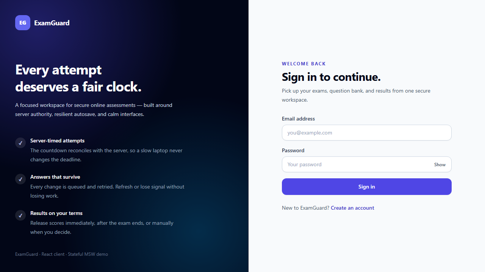 | 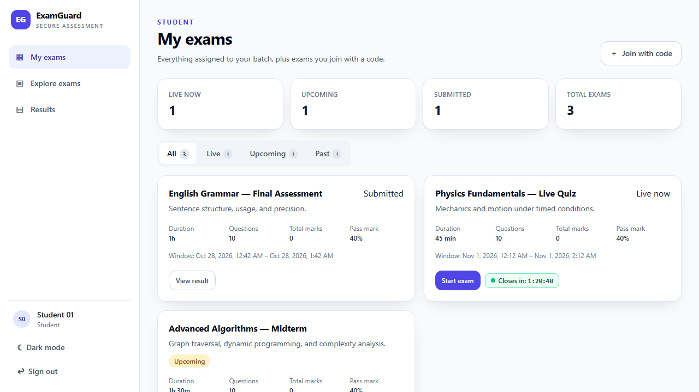 | 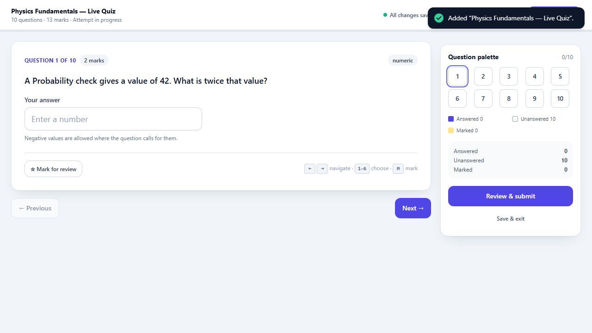 |

| Teacher Dashboard | Exam Builder | Live Monitor |
|:---:|:---:|:---:|
| 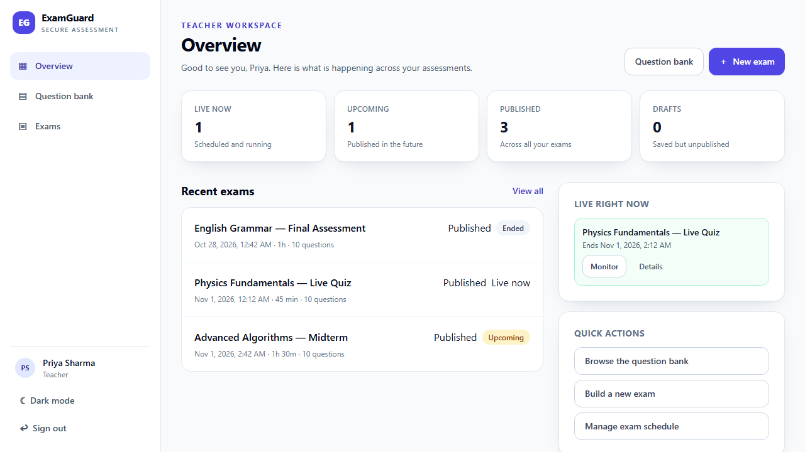 | 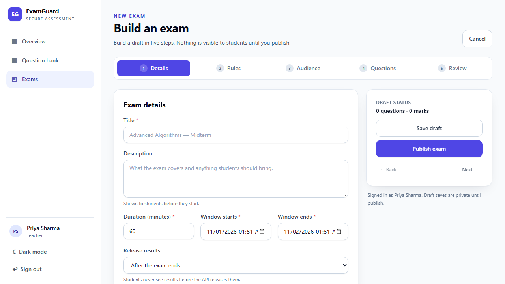 | 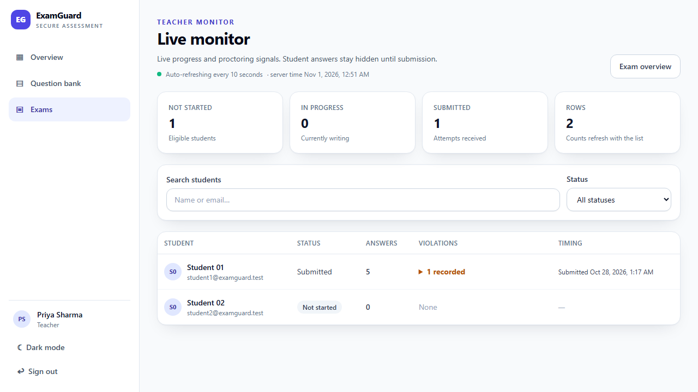 |

| Admin Dashboard | Questions List | Register |
|:---:|:---:|:---:|
| 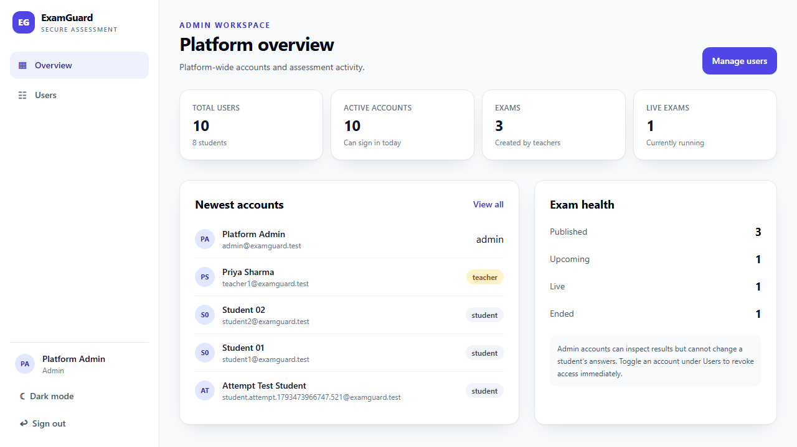 | 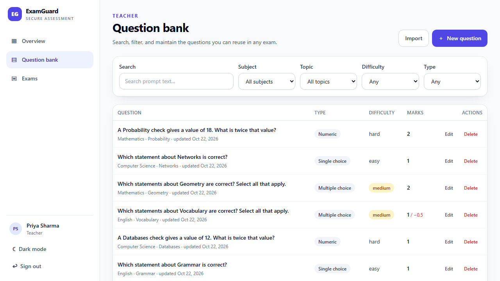 | 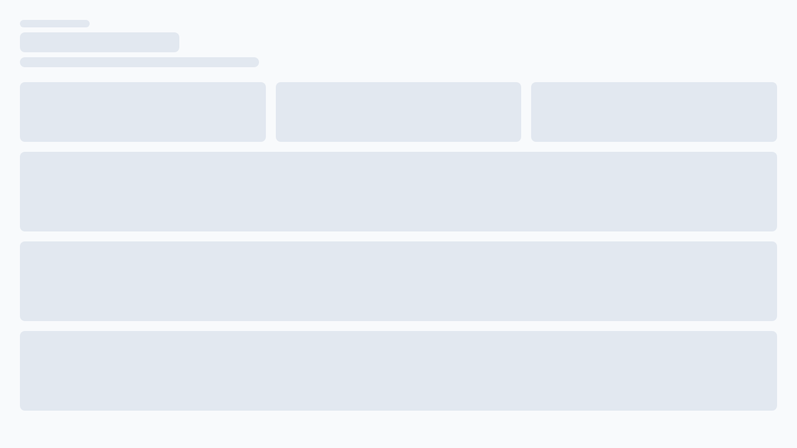 |

</details>

<details>
<summary><strong>📱 Mobile Views</strong> (click to expand)</summary>
<br/>

| Login | Student Dashboard | Attempt |
|:---:|:---:|:---:|
| 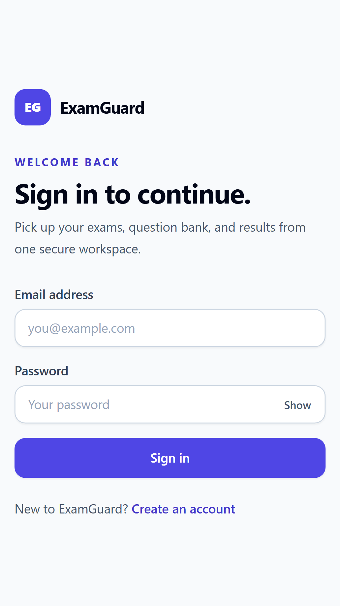 | 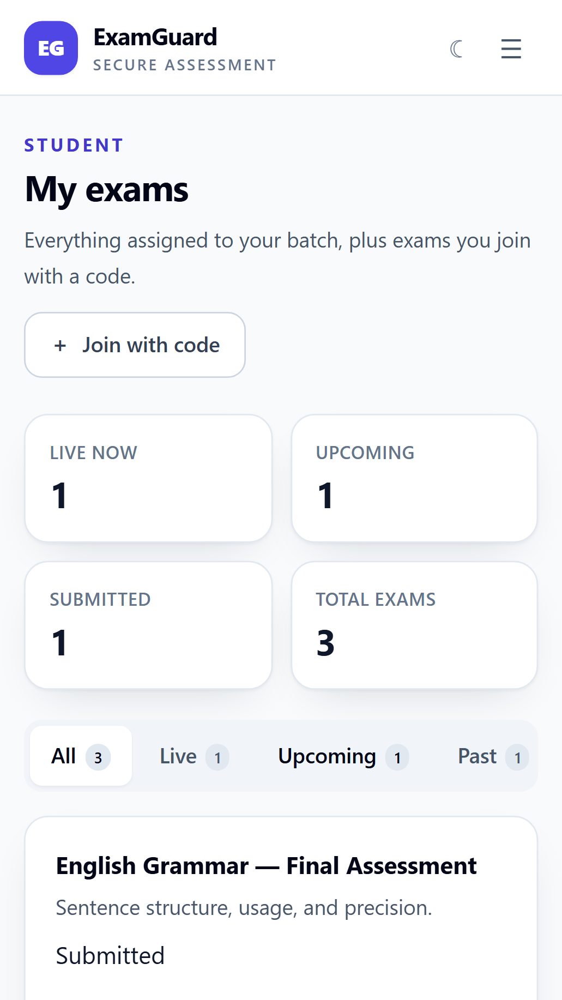 | 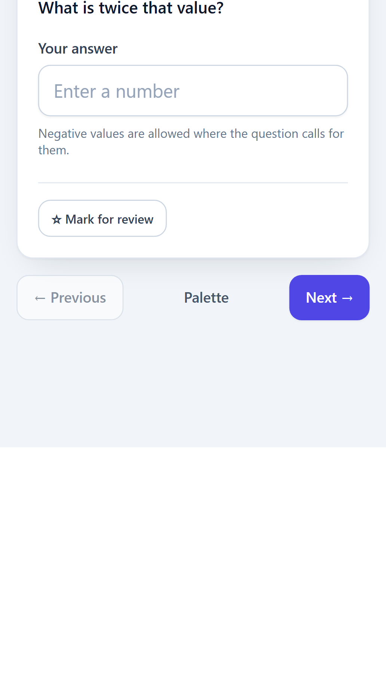 |

| Teacher Dashboard | Exam Builder | Monitor |
|:---:|:---:|:---:|
| 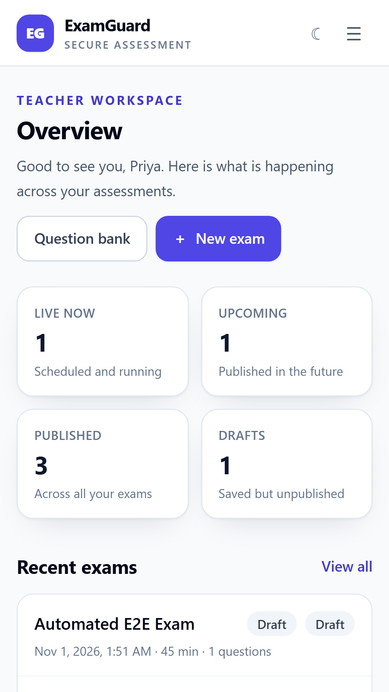 | 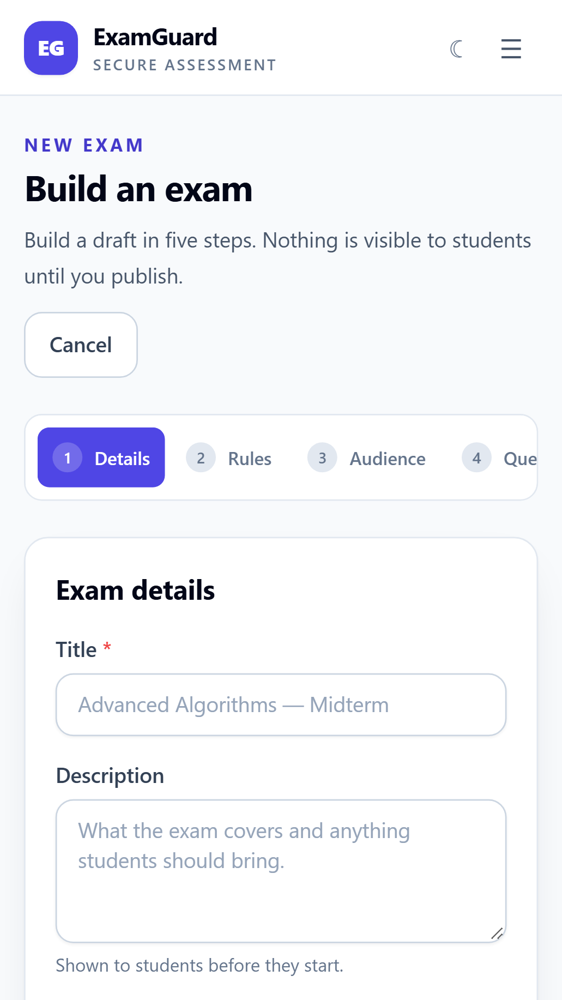 | 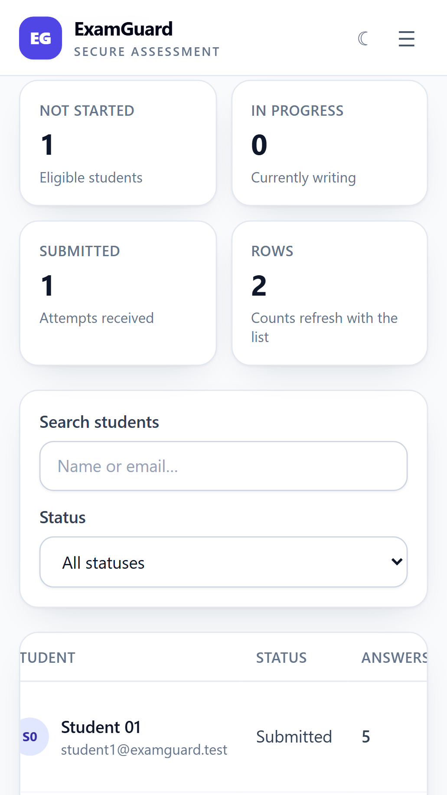 |

</details>

---

## 🏗️ Architecture

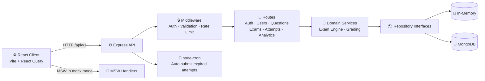

### How it works (simplified)

1. **Student** opens the React app → logs in → joins an exam with a code
2. **React client** talks to the Express API via REST endpoints (`/api/v1/...`)
3. **API middleware** validates the JWT token, checks the role, and validates the request body
4. **Exam Engine** manages the attempt — shuffles questions, tracks time, handles autosave
5. **On submit** → Server grades all answers, calculates scores, stores results
6. **Teacher** can monitor live attempts and review violations in real-time

---

## 🛠️ Tech Stack

| Layer | Technologies |
|---|---|
| **Frontend** | React 18, React Router, TanStack Query, React Hook Form, Zod, Zustand, Tailwind CSS 3.4, Recharts, dnd-kit, Vite, MSW |
| **Backend** | Node.js 20+, Express, Mongoose, JWT, bcrypt, Helmet, CORS, Morgan, Multer, node-cron |
| **Database** | MongoDB 7+ (or in-memory driver for development) |
| **Testing** | Jest, Supertest, MongoDB Memory Server, Vitest, Testing Library, Playwright |
| **Tooling** | ESLint, Prettier, npm workspaces, GitHub Actions CI |

---

## 🚀 Getting Started

### Prerequisites

| Requirement | Version | Required? |
|---|---|---|
| Node.js | 20 or newer | ✅ Yes |
| npm | (comes with Node) | ✅ Yes |
| MongoDB | 7+ | ❌ Optional (in-memory driver works without it) |

### 1. Clone & Install

```bash
git clone https://github.com/PramanWalia/examguard.git
cd examguard
npm install
```

### 2. Configure Environment

```bash
# Copy the example env file
cp server/.env.example server/.env
```

The defaults work out of the box for local development. Set `SEED_ON_START=true` in `server/.env` if you want demo fixtures automatically seeded on startup.

### 3. Start the App

You need **two terminals**:

```bash
# Terminal 1 — Start the API server
npm run dev
```

```bash
# Terminal 2 — Start the React client
npm run dev:client
```

### 4. Open in Browser

| URL | What it is |
|---|---|
| [http://localhost:5173](http://localhost:5173) | 🌐 React app |
| [http://localhost:5000/api/v1/health](http://localhost:5000/api/v1/health) | 💚 API health check |

### 5. Getting Started & User Accounts

ExamGuard enforces secure, production-ready authentication:

* **New Users (Students & Teachers):** Navigate to the login screen and click **Create an account** (or visit `/register`) to set up a new personal account.
* **Teacher Approval Flow:** Teachers can optionally provide an invite code or submit their account for administrator activation. Unapproved teachers cannot access questions or exams until an admin approves them.
* **Administrator Role & Protection:** System administrators oversee the platform from the `/users` console:
  - Approve or decline pending teacher accounts.
  - Safely switch existing accounts between **Student** and **Teacher** roles (the administrator role is strictly protected and cannot be assigned via the dropdown).
  - Provision or update an administrator account using environment variables (`ADMIN_EMAIL` and `ADMIN_PASSWORD`) or the CLI tool:
    ```bash
    ADMIN_EMAIL="admin@yourdomain.com" ADMIN_PASSWORD="YourStrongPassword1!" npm run create-admin --workspace @examguard/server
    ```
* **Private Demo Accounts:** For the repository owner, pre-configured demo and management credentials are stored in `PRIVATE_CREDENTIALS.md` (local only, protected by `.gitignore`).

> [!NOTE]
> Public demo credentials are never stored in production or repository documentation. Anyone wanting to use the application must register their own account.

---

## ☁️ Production Cloud Deployment

ExamGuard is live and deployed with automated GitHub CI/CD:

| Component | Platform | Live URL / Target | Notes |
|---|---|---|---|
| **Frontend UI** | [Vercel](https://vercel.com/) | [https://examguard-plum.vercel.app](https://examguard-plum.vercel.app) | React 18 + Vite SPA, auto-proxies `/api` via `vercel.json` |
| **Backend API** | [Railway](https://railway.app/) | [https://examguard-production-2ebb.up.railway.app](https://examguard-production-2ebb.up.railway.app) | Node.js + Express REST API, CORS & Helmet hardened |
| **Database** | [Railway MongoDB](https://railway.app/) | `mongodb-volume` | Persistent cloud volume storage |

### Continuous Deployment (CI/CD)
Both Vercel and Railway automatically deploy whenever code is pushed to the `main` branch of this repository:
```text
Local commit ➔ git push origin main ➔ Vercel (Frontend) & Railway (Backend) auto-redeploy in ~30s
```

---

## 🗄️ Using MongoDB

For persistent data (required in production), switch to MongoDB:

```dotenv
# In server/.env, change these:
REPOSITORY_DRIVER=mongo
MONGODB_URI=mongodb://127.0.0.1:27017/examguard
SEED_ON_START=false
```

Then create an admin account manually (or configure `ADMIN_EMAIL` & `ADMIN_PASSWORD` in your cloud variables):

```bash
ADMIN_EMAIL="your@email.com" ADMIN_PASSWORD="YourStrongPassword1" npm run create-admin --workspace @examguard/server
```

> [!IMPORTANT]
> For production, you **must** set unique, strong `JWT_ACCESS_SECRET` and `JWT_REFRESH_SECRET` values (64-character hex strings). The app will refuse to start with the development defaults when `NODE_ENV=production`.

---

## 📡 API Overview

All endpoints are prefixed with `/api/v1`. Here's a quick summary:

| Category | Endpoints | What it does |
|---|---|---|
| 🏥 **Health** | `GET /health` | Check if the server is running |
| 🔑 **Auth** | `POST /auth/register` · `/login` · `/refresh` · `/logout` · `GET /auth/me` | Sign up, log in, token refresh, log out |
| 👥 **Users** | `GET /users` · `PATCH /users/:id` · `DELETE /users/:id` | Admin manages user accounts |
| ❓ **Questions** | `GET /questions` · `POST /questions` · `PATCH /:id` · `DELETE /:id` · `POST /import` | Teacher manages question bank |
| 📝 **Exams** | `GET /exams` · `POST /exams` · `PATCH /:id` · `DELETE /:id` · `POST /:id/publish` · `POST /join` | Create, edit, publish, and join exams |
| ⏱️ **Attempts** | `POST /exams/:id/start` · `PATCH /attempts/:id/answer` · `POST /:id/submit` | Start exam, save answers, submit |
| 📊 **Results** | `GET /attempts/:id/result` | View graded results |
| 👁️ **Monitoring** | `POST /attempts/:id/violation` · `GET /exams/:id/monitor` | Report & view integrity violations |
| 📈 **Analytics** | Routes under `/analytics` | Score distributions, history, summaries |

📄 Full details → [`docs/API_CONTRACT.md`](docs/API_CONTRACT.md)

---

## 🧪 Running Tests

```bash
# Run all backend tests (unit + integration)
npm test

# Run contract tests specifically
npm run test:contract --workspace @examguard/server

# Run MongoDB-specific tests (needs MongoDB running)
npm run test:mongo --workspace @examguard/server

# Run frontend tests
npm run test --workspace @examguard/client

# Lint all code
npm run lint

# Build the client (checks for compile errors)
npm run build

# Run end-to-end tests with Playwright
npx playwright test
```

### What the tests cover

| Area | What's tested |
|---|---|
| **Repository contracts** | CRUD operations, uniqueness, pagination for all entity types |
| **Auth flows** | Register, login, token rotation, logout, role guards |
| **Exam engine** | Shuffle-once, autosave, stale-update rejection, grace period, idempotent submit |
| **Grading** | Single-choice, multi-choice, numeric, negative marks, partial marks |
| **E2E (Playwright)** | Full user flows — auth, teacher exam creation, student attempts, admin management |

---

## 🔑 Key Design Decisions

<details>
<summary><strong>Why is the server authoritative for time?</strong></summary>

Browser clocks can be wrong or manipulated. The server computes all timing — attempt start, expiry, exam phase, grace windows, and result availability — from its own clock. This prevents students from extending their exam time.
</details>

<details>
<summary><strong>Why are published exams immutable snapshots?</strong></summary>

When a teacher publishes an exam, the system takes a snapshot of all questions (text, options, answers, marks). This means editing a question in the question bank after publishing won't affect any active exam.
</details>

<details>
<summary><strong>Why the Repository Pattern?</strong></summary>

Services talk to abstract repository interfaces, not directly to MongoDB. Switching between `REPOSITORY_DRIVER=memory` (for development/tests) and `REPOSITORY_DRIVER=mongo` (for production) requires zero code changes — just an environment variable.
</details>

<details>
<summary><strong>Why is submission idempotent?</strong></summary>

Network issues can cause duplicate submit requests. The `finalizeIfInProgress` function does a conditional state transition — if the attempt is already submitted, it returns the existing result instead of grading again. This prevents score inconsistencies.
</details>

<details>
<summary><strong>How does autosave work?</strong></summary>

Every answer includes a `clientSeq` (sequence number) and timestamp. The server rejects any update where the sequence number is lower than what's already saved — preventing stale writes from overwriting newer answers, even with network delays.
</details>

---

## 📁 Project Structure

```
examguard/
├── client/                    # React frontend
│   ├── src/
│   │   ├── components/        # Reusable UI components
│   │   ├── hooks/             # Custom hooks (timer, autosave, anti-cheat, etc.)
│   │   ├── pages/             # Route-level page components
│   │   ├── store/             # Zustand state stores
│   │   ├── mocks/             # MSW mock handlers & seed data
│   │   ├── api/               # API client
│   │   ├── utils/             # Helpers (formatting, constants, errors)
│   │   └── tests/             # Vitest unit tests
│   └── public/                # Static assets
│
├── server/                    # Express backend
│   ├── src/
│   │   ├── routes/            # API route handlers
│   │   ├── services/          # Business logic (auth, exam engine, grading)
│   │   ├── repositories/      # Data access layer (memory + MongoDB)
│   │   ├── models/            # Mongoose schemas
│   │   ├── middleware/        # Auth, validation, error handling, rate limiting
│   │   ├── validators/        # Zod request schemas
│   │   ├── utils/             # Shared utilities
│   │   ├── config/            # Environment & database config
│   │   ├── jobs/              # Cron jobs (auto-submit expired attempts)
│   │   └── tests/             # Jest integration tests
│   └── .env.example           # Environment variable template
│
├── e2e/                       # Playwright end-to-end tests
├── screenshots/               # UI screenshots (desktop + mobile)
├── docs/                      # Project documentation
│   ├── API_CONTRACT.md        # Complete API specification
│   ├── FRONTEND_NOTES.md      # Client architecture notes
│   ├── SERVER_NOTES.md        # Server architecture notes
│   └── DATABASE_NOTES.md      # MongoDB setup guide
└── package.json               # Root workspace config
```

---

## ⚠️ Limitations & Future Work

- **Browser proctoring ≠ proof of cheating.** Tab switches and copy/paste events are *signals* that support human review — they can be spoofed, blocked, or triggered by innocent actions. They should never be used for automated accusations.
- **Production Architecture:** Deployed live with Vercel (Edge CDN) + Railway (Containerized Express) + Railway persistent MongoDB volume. Further scaling would introduce horizontal auto-scaling and Redis session clustering.
- **Analytics** can be optimized with materialized aggregates and background processing for larger cohorts.
- **Accessibility & localization** should be expanded before institutional rollout.

---

## 📚 Documentation

| Document | Description |
|---|---|
| [`API_CONTRACT.md`](docs/API_CONTRACT.md) | Complete API specification — endpoints, schemas, status codes, auth rules |
| [`FRONTEND_NOTES.md`](docs/FRONTEND_NOTES.md) | Client architecture, routing, state management, MSW mocking |
| [`SERVER_NOTES.md`](docs/SERVER_NOTES.md) | Server architecture, security, exam engine, grading logic |
| [`DATABASE_NOTES.md`](docs/DATABASE_NOTES.md) | MongoDB setup, indexes, replica sets, Atlas deployment |

---

<div align="center">

**Built with ❤️ by [Praman Walia](https://github.com/PramanWalia)**

</div>
